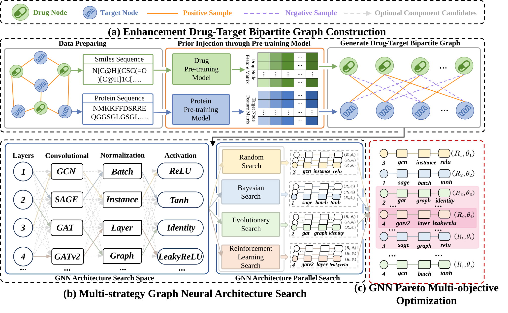

# P2GNAS-DTI
P2GNAS-DTI is an innovative computational framework for drug-target interaction (DTI) prediction that combines pre-trained biological language models with multi-strategy graph neural architecture search (GNAS). It overcomes the limitations of traditional models by:

* **Injecting Prior Knowledge:** Using pre-trained models (MoLFormer and ESM) to encode drug and protein sequences, capturing essential 3D structural and evolutionary context.

* **Adaptive Model Design:** Utilizing parallel search strategies (Random, Bayesian, Evolutionary, and Reinforcement Learning) to automatically discover the optimal graph neural network (GNN) architecture for different datasets.

* **Optimizing Complexity:** Employing Pareto multi-objective optimization to balance high predictive performance with efficient model complexity.

* **The framework of P2GNAS-DTI is as follows:**


## Install based on Ubuntu 24.04
Ensure you have installed CUDA 11.8 before installing other packages

**1.Python environment:** recommending using Conda package manager to install
```
conda create -n P2GNAS-DTI python=3.9
conda activate P2GNAS-DTI
```

**2.Python package:**
```
torch == 2.2.1
torch-geometric == 2.6.1
torch-scatter == 2.1.2+pt22cu118
torch-sparse == 0.6.18+pt22cu118
torch-cluster == 1.6.3+pt22cu118
```

## Quick Start
###  Architecture Search
To search for the optimal GNN architecture using the parallel strategy:
```
python Code/search_architecture/parallel/parallel.py
```
### Evaluation
Run the optimal architecture on a specific dataset from {DrugBank, BioSNAP, BindingDB, DAVIS, E, IC, GPCR, NR}.
```
python3 Code/main.py -d <dataset> -e <embedding_dimension>
(e.g., dataset==E,embedding_dimension==60):python3 Code/main.py -d E -e 60
```
### Generalization capabilities 
Evaluates the model's robustness and cross-dataset transferability to ensure reliable DTI predictions for novel drugs and targets.
```
python3 Code/execute4generalization.py 
```
